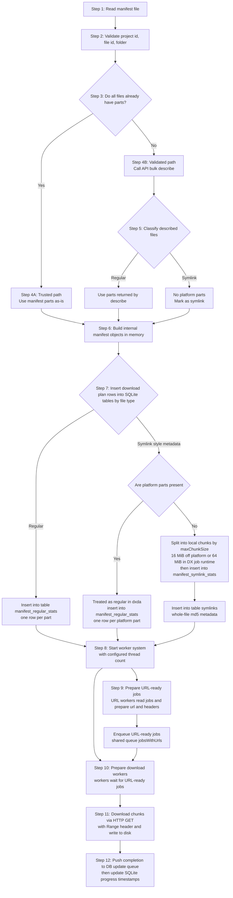
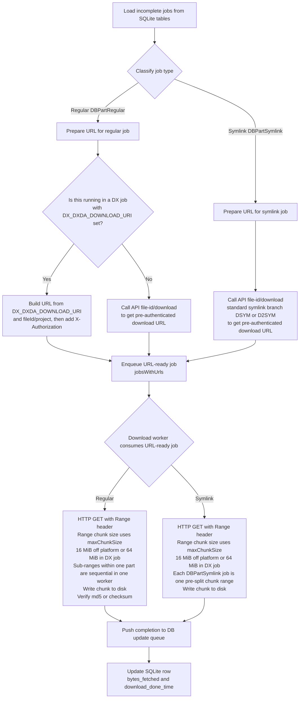
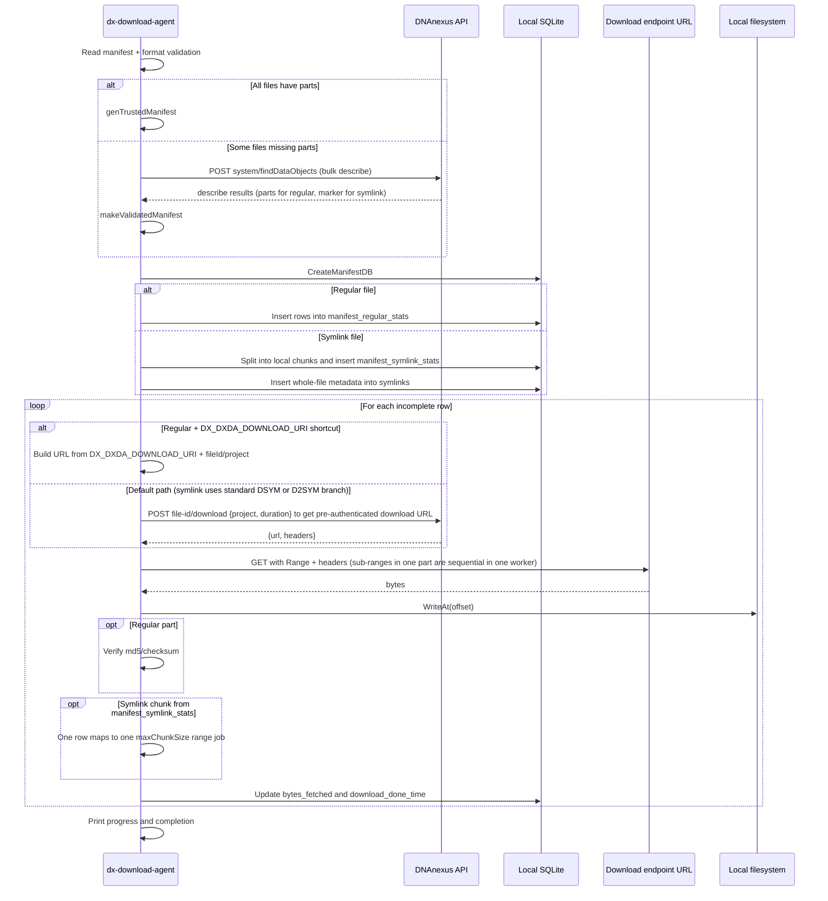

# DXDA Download Flow (Regular + Symlink)

## Purpose

This document explains how `dx-download-agent` (dxda) downloads files in the current implementation.

It covers:

1. Regular file download path
2. Symlink file download path
3. Where the flow branches
4. What is platform metadata vs local download metadata

## One-Page Summary

1. dxda reads and validates the manifest JSON.
2. If all files already include `parts`, dxda trusts those parts and skips describe.
3. If any file is missing `parts`, dxda bulk-describes files via `system/findDataObjects`.
4. After describe, dxda classifies each file:
   - Regular file: has regular `parts`
   - Symlink file: `parts` is absent and `drive` is present
5. dxda writes download work items into SQLite:
   - `manifest_regular_stats`: one row per regular part
   - `manifest_symlink_stats`: one row per local symlink chunk
   - `symlinks`: one row per symlink file (whole-file md5 metadata)
6. Workers fetch download URLs and perform HTTP `GET` with `Range`.
7. Progress and resume state are updated in SQLite.

## Manifest Input Format (Recommended)

The manifest is a JSON map from `project-xxxx` (or `container-xxxx`) to a list of files.

### A) Regular file with parts already present (trusted path eligible)

```json
{
    "project-AAAA": [
        {
            "id": "file-REG001",
            "name": "tumor.bam",
            "folder": "/bam",
            "parts": {
                "1": { "size": 10485760, "md5": "11111111111111111111111111111111" },
                "2": { "size": 5242880,  "md5": "22222222222222222222222222222222" }
            }
        }
    ]
}
```

### B) File without parts (validated path will call API bulk describe)

```json
{
    "project-AAAA": [
        {
            "id": "file-ANY001",
            "name": "needs-describe.dat",
            "folder": "/incoming"
        }
    ]
}
```

### C) Symlink-style entry (typically no parts in manifest)

```json
{
    "project-AAAA": [
        {
            "id": "file-SYM001",
            "name": "linked.vcf.gz",
            "folder": "/links"
        }
    ]
}
```

## High-Level Diagram (Easy Step-by-Step)



## Runtime Download Diagram (Workers)

Note: This diagram is a zoom-in of Step 9 through Step 12 from the High-Level Diagram.
It shows explicit branches for regular and symlink jobs.



## Sequence Diagram (End-to-End)



## Edge Case to Know

If describe returns `parts=nil` and `drive=nil`, current logic treats it as regular with zero parts. That can result in no download jobs for that file.
