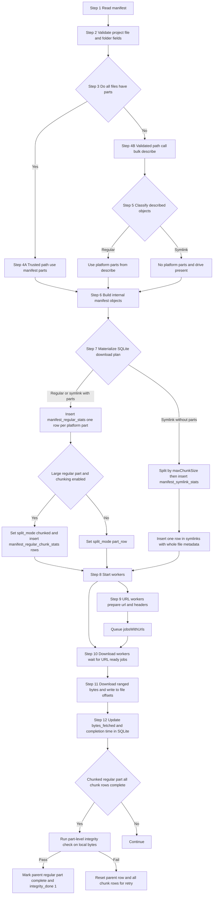
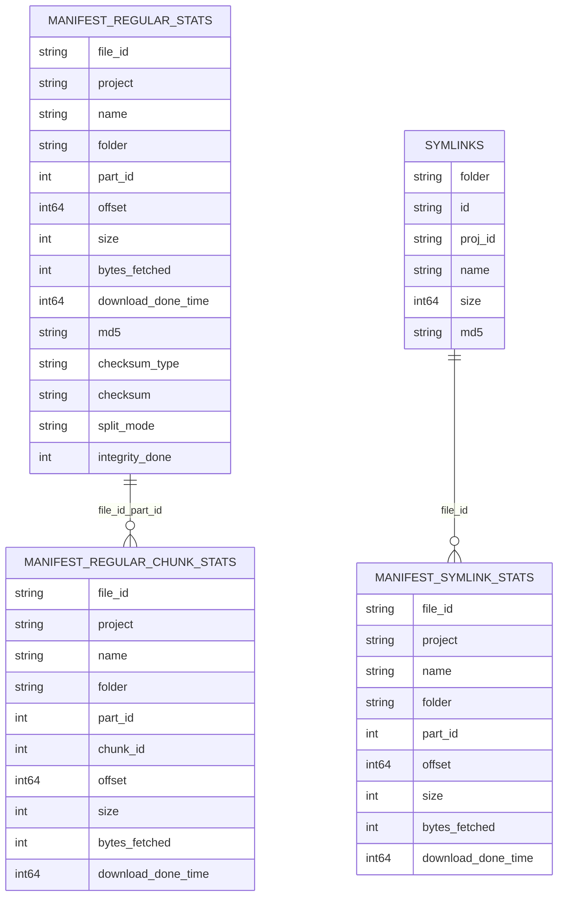
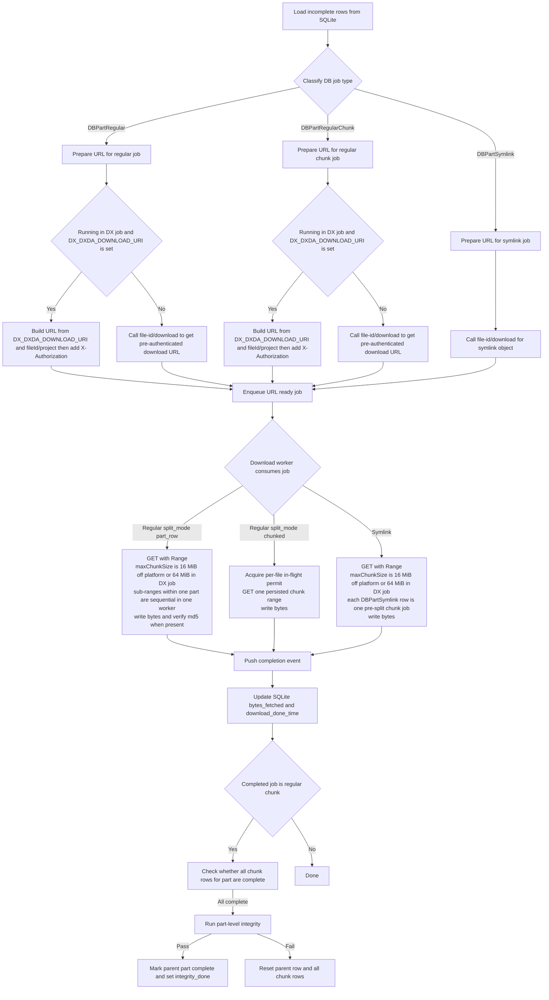
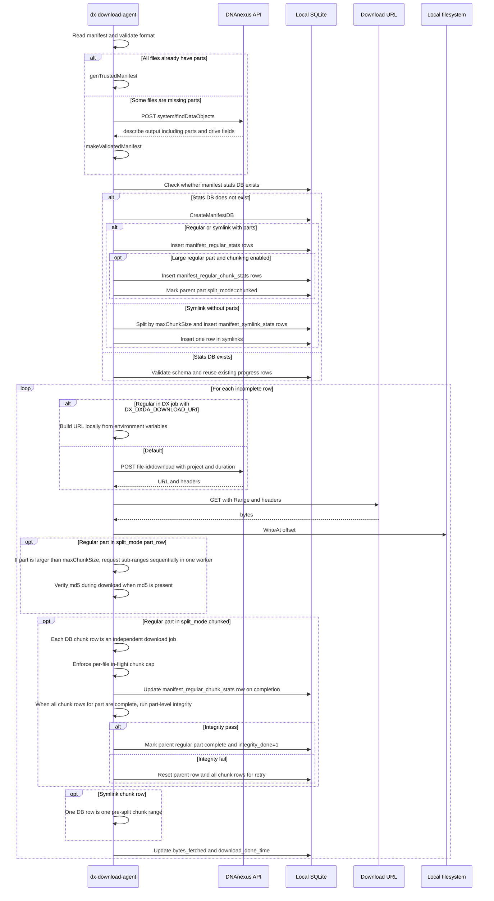

# DXDA Download Flow (Regular and Symlink)

## Purpose

This document explains the current DXDA download flow end to end, including:

1. How manifest input is interpreted
2. How regular and symlink files are classified
3. How jobs are materialized into SQLite
4. How URL preparation and ranged download happen at runtime
5. How large regular parts are split into persisted chunk jobs with finalize integrity

## One-Page Summary

1. DXDA reads and validates the manifest.
2. If every file already has parts, DXDA uses trusted mode and skips bulk describe.
3. If any file is missing parts, DXDA bulk describes via `system/findDataObjects`.
4. Classification after describe is shape based:
   - Symlink if `parts == nil` and `drive != nil`
   - Regular otherwise
5. SQLite planning tables are populated:
    - `manifest_regular_stats`: one row per platform part, with `split_mode` and `integrity_done`
    - `manifest_regular_chunk_stats`: one row per persisted chunk for large regular parts
    - `manifest_symlink_stats`: one row per local chunk for symlink objects without platform parts
    - `symlinks`: one row per symlink object for whole file metadata
6. URL workers prepare pre-authenticated download URLs.
7. Download workers convert each planned part or chunk row (`offset`, `size`) into a byte range (`Range: bytes=start-end`), then issue HTTP `GET` and write to local offsets.
8. For chunked regular parts, DXDA finalizes at part level only after all chunk rows complete and integrity passes.
9. Progress and resume state are updated in SQLite.

## Manifest Input Format

The manifest is a map from `project-xxxx` or `container-xxxx` to a list of files.

Expected file format in practice:

1. Recommended filename suffix: `*.json.bz2`.
2. DXDA does not enforce the suffix string directly.
3. DXDA always reads the file as BZip2-compressed bytes and then parses JSON.
4. So the actual content must be valid `BZip2 + JSON`, even if the filename uses a different suffix.

### Regular file with parts

```json
{
    "project-AAAA": [
        {
            "id": "file-REG001",
            "name": "tumor.bam",
            "folder": "/bam",
            "parts": {
                "1": { "size": 10485760, "md5": "11111111111111111111111111111111" },
                "2": { "size": 5242880,  "md5": "22222222222222222222222222222222" }
            }
        }
    ]
}
```

### File without parts

```json
{
    "project-AAAA": [
        {
            "id": "file-ANY001",
            "name": "needs-describe.dat",
            "folder": "/incoming"
        }
    ]
}
```

### Symlink style entry

```json
{
    "project-AAAA": [
        {
            "id": "file-SYM001",
            "name": "linked.vcf.gz",
            "folder": "/links"
        }
    ]
}
```

## High-Level Flow

This diagram is the end-to-end control flow.
Step 7 is the data-model handoff where DXDA writes jobs into SQLite tables.
The next section explains those planning tables in detail.



## Step 7 Data Model: SQLite Tables and Entities

DXDA uses four planning tables with different responsibilities.

### 1) manifest_regular_stats

1. One row per platform part.
2. Stores per-part scheduling and progress.
3. Stores per-part integrity metadata for regular flow (`md5`, `checksum_type`, `checksum`).

### 2) manifest_regular_chunk_stats

1. One row per persisted chunk for large regular parts in `split_mode = chunked`.
2. Stores chunk `offset`, `size`, `bytes_fetched`, and `download_done_time`.
3. Used for parallel chunk download and resume of large regular parts.

### 3) manifest_symlink_stats

1. One row per local symlink chunk created by DXDA when platform parts are absent.
2. Stores chunk `offset`, `size`, `bytes_fetched`, and `download_done_time`.
3. Used for parallel chunk download and resume.

### 4) symlinks

1. One row per symlink file.
2. Stores whole-file metadata (`size`, `md5`) for final integrity check.
3. Linked to rows in `manifest_symlink_stats` through `file_id`.

### Entity Diagram (ERD)



## Runtime Worker Flow

This zooms into Step 9 through Step 12.



## Sequence Diagram

This sequence is the same end-to-end path shown earlier, but expressed as interactions between components.
It reuses the same step numbering so you can map directly to the previous sections:

1. Step 1 to Step 6: manifest read, validation, and trusted or validated manifest construction.
2. Step 7: SQLite plan materialization, matching the table roles in Step 7 Data Model.
3. Step 8 to Step 10: worker startup and URL preparation, matching Runtime Worker Flow.
4. Step 11 to Step 12: ranged download, local writes, and SQLite progress updates.



## Notes

1. Symlink object with `parts`:
    - It does not go through the local symlink chunk-splitting path.
    - It is handled as part-based download and inserted into `manifest_regular_stats`.

2. Large regular part behavior:
    - If chunking is disabled, or part size does not cross the split threshold, it stays `split_mode = part_row`.
    - If chunking is enabled and part size crosses the threshold, it becomes `split_mode = chunked` and gets persisted chunk rows in `manifest_regular_chunk_stats`.

3. Symlink without `parts`:
    - DXDA pre-splits it into multiple rows in `manifest_symlink_stats`.
    - These chunk rows can be downloaded in parallel by multiple workers.

4. Resume after interruption:
    - DXDA reloads incomplete rows from SQLite.
    - It resumes from `bytes_fetched` and updates `download_done_time` on completion.
    - For chunked regular parts, parent completion is derived after all chunk rows finish and finalize integrity passes.

5. Different integrity checks by phase and type:
    - Download phase (regular): validates part MD5 when MD5 is present.
    - Download phase (chunked regular): validates full part after all chunk rows complete; on failure, parent and chunk rows are reset.
    - Inspect phase (regular): validates MD5 or checksumType/checksum metadata.
    - Inspect phase (symlink): validates whole-file MD5 from `symlinks`.

